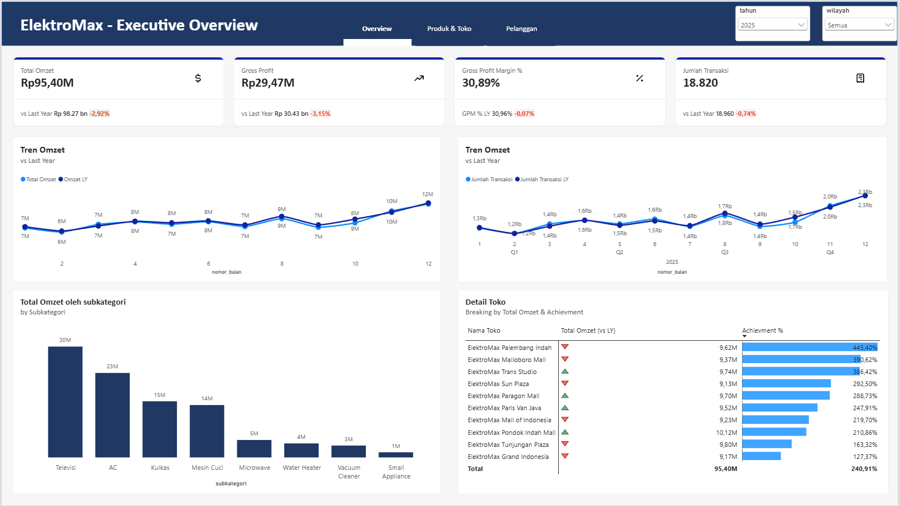
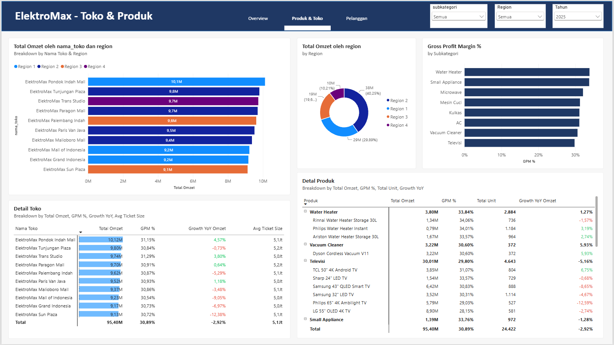
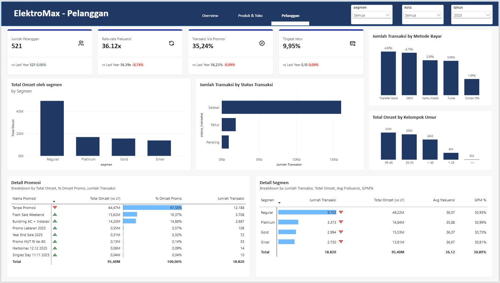

# ElektroMax Retail Analysis

**Dari data mentah ke keputusan bisnis: analisis 3 tahun penjualan retail elektronik dengan Power Query, Power BI, dan PostgreSQL.**

  

[](https://app.powerbi.com/groups/me/reports/063b76b7-cfcb-4d24-b211-13172549180c/90e0c2122ec17997da2e?experience=power-bi)

## Ringkasan

ElektroMax adalah jaringan retail elektronik rumah tangga dengan **10 cabang** di 8 kota besar Indonesia, **30 produk** (Samsung, LG, Sharp, Panasonic, Daikin, dll.), dan **521 pelanggan** dengan 4 level membership. Datanya mencakup **Januari 2023 – Desember 2025** (56.000+ transaksi).

**Pertanyaan utama:** omzet 2025 turun 2,92% dibanding 2024. Apa penyebabnya, bagian bisnis mana yang paling terdampak, dan keputusan apa yang perlu diambil?

## Deck

Ringkasan lengkap proyek (16 slide, termasuk insight dan rekomendasi) bisa dibaca di sini:

| Format | Link |
|---|---|
| Baca langsung | [Ringkasan lengkap (PDF)](https://drive.google.com/file/d/1VUDjdn0dsU6_-K1bHiEcyzhlzQf7ebsS/view?usp=sharing) |

## Preview Dashboard

Klik gambar atau [buka dashboard interaktif di Power BI](https://app.powerbi.com/groups/me/reports/063b76b7-cfcb-4d24-b211-13172549180c/90e0c2122ec17997da2e?experience=power-bi) untuk mencoba filter dan drill-down langsung.

| Overview | Toko & Produk | Pelanggan |
|---|---|---|
| [](https://app.powerbi.com/groups/me/reports/063b76b7-cfcb-4d24-b211-13172549180c/90e0c2122ec17997da2e?experience=power-bi) | [](https://app.powerbi.com/groups/me/reports/063b76b7-cfcb-4d24-b211-13172549180c/90e0c2122ec17997da2e?experience=power-bi) | [](https://app.powerbi.com/groups/me/reports/063b76b7-cfcb-4d24-b211-13172549180c/90e0c2122ec17997da2e?experience=power-bi) |

## Alur Pengerjaan

1. **Cleaning (Power Query):** data mentah dari Excel dimuat ke Power BI, lalu dibersihkan lewat Transform Data.
2. **Visualisasi (Power BI):** data bersih dimuat untuk membangun dashboard 3 halaman.
3. **Analisis (PostgreSQL):** dikerjakan terakhir pada dataset yang sudah bersih. Isinya identik dengan hasil cleaning di Power Query.

## Data Cleaning: 4 Masalah Utama

| Masalah | Sebelum | Sesudah |
|---|---|---|
| Format harga | `"Rp 15.999.000"` (teks) | `15999000` (integer) |
| Metode bayar | `cash`, `CC`, `Credit Card`, `Q-RIS`, dst. | 5 nilai: Tunai, Kartu Kredit, QRIS, Transfer Bank, Cicilan 0% |
| Status transaksi | `Done`, `Complete`, `Sukses`, `Return`, `RETUR` | 3 nilai: Selesai, Retur, Pending |
| Null & duplikat | subkategori kosong 6%, email null, baris ganda | terisi 100%, email "Tidak Tersedia", duplikat dihapus |

Detail langkah dan screenshot ada di [`01_Data_Cleaning`](01_Data_Cleaning).

## Analisis SQL: Temuan Kunci

Seluruh query memakai transaksi berstatus `Selesai` (48.182 transaksi, omzet Rp247,1 miliar untuk 2023–2025). Skema star schema (1 tabel fakta, 6 dimensi) ada di [`03_SQL_Queries`](03_SQL_Queries).

- **Toko:** omzet 10 toko sangat merata (selisih tertinggi dan terendah hanya 4%); 5 toko di atas rata-rata Rp24,71 miliar.
- **Merek:** Samsung (23,63%) dan LG (22,82%) menyumbang 46% omzet. LG mencapainya dengan transaksi separuh Samsung karena nilai per transaksinya lebih tinggi.
- **Promosi:** margin transaksi promo 25,13% vs 33,70% tanpa promo, dengan nilai transaksi 12% lebih kecil.
- **Pembayaran:** Transfer Bank dan QRIS dipakai 50% transaksi.
- **Segmen:** Regular menyumbang 51,7% transaksi; nilai belanja rata-rata hampir sama di semua segmen (Rp5,09–5,28 juta).

## Dashboard Power BI (2025)

| Halaman | Yang dijawab |
|---|---|
| Overview | Omzet Rp95,40 M (−2,92%), margin 30,89%, 18.820 transaksi, tren vs tahun lalu, performa toko vs target |
| Toko & Produk | Omzet per region/toko/produk, margin per subkategori, pertumbuhan YoY |
| Pelanggan | Segmen, kelompok umur, metode bayar, efektivitas promo, tingkat retur 9,95% |

Filter interaktif: tahun, wilayah/region, subkategori, segmen, dan kota.

## Insight & Rekomendasi

| Temuan | Rekomendasi |
|---|---|
| Omzet TV turun 5,16% dan kontribusinya terbesar | Review harga dan stok TV; dorong Water Heater (margin 33,8%) dan Vacuum Cleaner (+5,9%) |
| Promo menggerus margin; 67,6% omzet 2025 tanpa promo | Batasi diskon luas; pertahankan Bundling AC+Instalasi dan Flash Sale |
| 6 dari 10 toko turun (Sun Plaza −12,4%, MOI −9,1%) | Audit stok, traffic, dan promo lokal; replikasi praktik Pondok Indah Mall (+4,6%) |
| Retur 9,95% | Telusuri retur per produk dan merek; program upgrade Regular ke Silver/Gold |
| Achievement toko 127–445% (target hanya Rp39,6 M/tahun) | Kalibrasi ulang target per toko berdasarkan potensi dan tren historis |

> Catatan: analisis promo menunjukkan dampak ke margin dan nilai transaksi, tetapi belum membuktikan apakah promo menambah volume dibanding kondisi tanpa promo. Itu butuh analisis lanjutan.

## Struktur Folder

```
01_Elektromax_Retail_Analysis/
├── 01_Data_Cleaning_Docs/     # dokumentasi & kode Power Query
├── 02_PowerBI_Dashboard/      # file .pbix + screenshot 3 halaman
├── 03_SQL_Queries/            # schema + query analisis (PostgreSQL)
└── README.md
```

## Catatan & Kredit

Proyek ini adalah hasil praktik dari Dataset dan studi kasus fiktif.

Sumber Dataset : [@alvinowrp](https://youtu.be/kOg4RCq8aW4?si=z3BF-fN8z5aeFgER)

## Kontak

**Ashar Krisna Prasetya** | [LinkedIn](https://www.linkedin.com/in/ashar-krisna-51257b252/) | [Email](mailto:asharkrisna2603@gmail.com) | [Portofolio lain](../README.md)
=======


