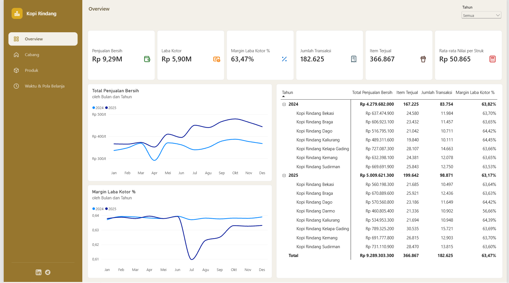
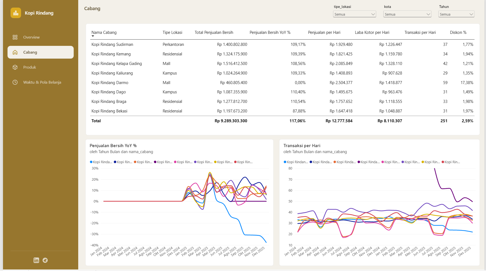
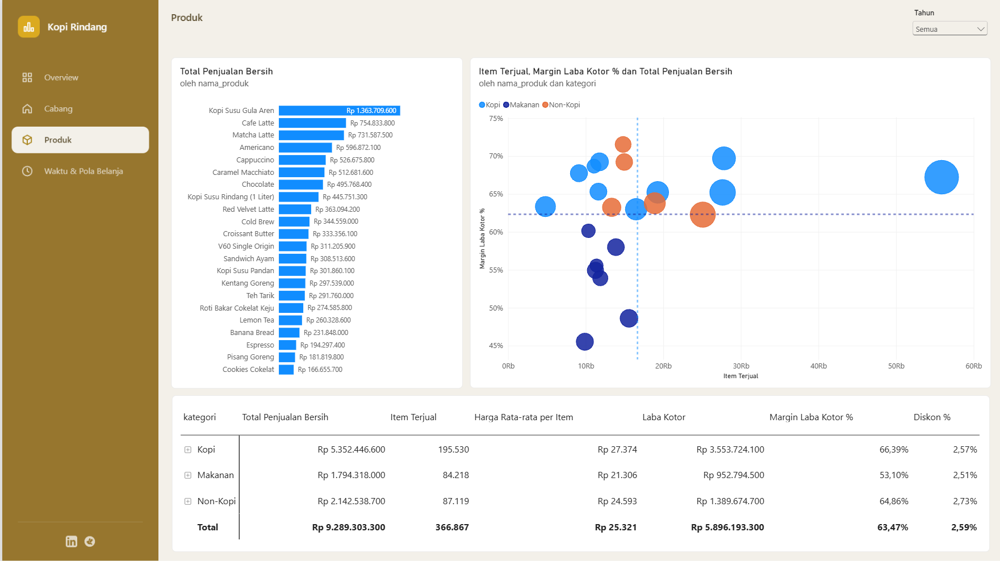
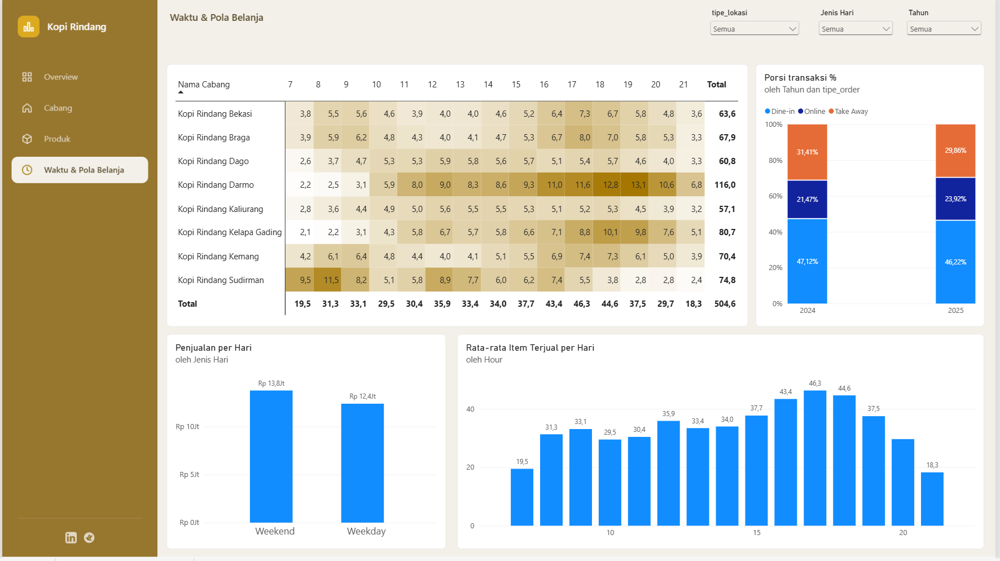

# Kopi Rindang: Analisis Penjualan Jaringan Coffee Shop

**Dari data kasir (POS) yang berantakan menjadi dashboard dan rekomendasi bisnis untuk 8 cabang, 22 menu, dan 24 bulan transaksi.**

  

[](https://app.powerbi.com/groups/me/reports/b09bd41f-4e8b-4f6c-b55d-36fc4ea30363/a5232e1aa4a74ed5cf1a?experience=power-bi)

> Kopi Rindang adalah perusahaan fiktif yang dibuat untuk keperluan portofolio.

## Ringkasan

Kopi Rindang punya **8 cabang** di Bandung, Jakarta, Bekasi, Yogyakarta, dan Surabaya, dengan 4 tipe lokasi (Kampus, Residensial, Perkantoran, Mall) dan **22 menu** dalam 3 kategori. Data penjualan masih berupa export mentah dari sistem kasir, sehingga manajemen belum punya gambaran terpadu tentang tren, cabang, produk, dan jam ramai.

**Tujuan:** membangun dashboard yang menjawab lima pertanyaan bisnis, lalu menerjemahkannya menjadi rekomendasi.

1. Bagaimana tren penjualan dan margin sepanjang 2024–2025?
2. Cabang dan tipe lokasi mana yang tumbuh, mana yang tertinggal?
3. Menu dan kategori mana yang paling besar kontribusi dan margin-nya?
4. Kapan pelanggan paling ramai, dan bagaimana pola jenis pesanannya?
5. Apa dampak cabang baru (Darmo) dan menu baru (Kopi Susu Pandan)?

## Akses Cepat

| | Link |
|---|---|
| Dashboard Power BI | [01_Project_Kopi_Rindang.pbix](02_PowerBI_Dashboard/01_Project_Kopi_Rindang.pbix) |
| Dokumentasi cleaning | [01_Cleaning_Kopi_Rindang.pdf](01_Cleaning_Data/01_Cleaning_Kopi_Rindang.pdf) |
| Dataset | [Google Sheets](https://docs.google.com/spreadsheets/d/1xLbSJd9RAthprxuNRJS9Kr9Xdw9DcMnW/edit?usp=sharing) |

## Pitch Deck

Ringkasan lengkap proyek (14 slide, termasuk insight dan rekomendasi) bisa dibaca di sini:

| Format | Link |
|---|---|
| Baca langsung | [Ringkasan lengkap (PDF)](https://drive.google.com/file/d/1tSLhh8GhcVJKcmJZkhSU0pr_zs3y_JG7/view?usp=sharing) |

## Data

| | |
|---|---|
| **Periode** | Januari 2024 – Desember 2025 |
| **Skala** | 182.625 struk (±250 transaksi/hari) dan 366.867 item terjual |
| **Tabel** | Penjualan (fakta), Cabang, Produk, Kalender (dibuat dengan DAX) |

## Data Cleaning: 4 Masalah Utama

| Masalah di data mentah | Solusi |
|---|---|
| Baris judul, baris kosong, baris TOTAL bawaan POS, dan spasi pada kode cabang | Skip Top Rows, hapus baris kosong dan TOTAL, `Text.Trim` + `Text.Upper` |
| 13 variasi penulisan metode bayar (qris, Qris, TUNAI, dst.) | Replace Values hingga tersisa 4 kategori: E-Wallet, QRIS, Tunai, Kartu Debit |
| 83% nilai diskon kosong (null) | Replace null menjadi 0 agar penjualan bersih terhitung tanpa error |
| Format tanggal dd/MM/yyyy terbaca format US (61% baris error) | Change Type Using Locale, 100% tanggal berhasil dikonversi |

Detail before/after ada di [dokumen cleaning](01_Cleaning_Data/01_Cleaning_Kopi_Rindang.pdf).

## Preview Dashboard (4 Halaman)

| Overview | Cabang |
|---|---|
|  |  |

| Produk | Waktu & Pola Belanja |
|---|---|
|  |  |

## Insight Utama

| Area | Temuan |
|---|---|
| **Pertumbuhan** | Penjualan bersih 2025 naik **17,1%** (Rp 5,01 M vs Rp 4,28 M). Total 2 tahun Rp 9,29 M dengan margin laba kotor 63,47%. |
| **Cabang** | Enam cabang tumbuh 8,6–10,5%, sedangkan **Bekasi turun 12,1%** (pada September 2025 turun 30,8% YoY). |
| **Darmo (cabang baru)** | Paling ramai dengan 59 transaksi/hari, tetapi diskon **17,4%** (cabang lain 1,3–2,2%) menekan margin ke 56,7%. Tanpa Darmo, margin 2025 tetap ±63,8%, sama dengan 2024. |
| **Produk** | Kopi Susu Gula Aren menyumbang **14,7%** penjualan. Margin Makanan (53,1%) lebih rendah dari Kopi (66,4%). Kopi Susu Pandan masuk peringkat 14 dari 22 menu hanya dalam 9 bulan. |
| **Waktu** | Jam tersibuk pukul **16.00–18.00**; penjualan per hari di akhir pekan sekitar **11% lebih tinggi**; porsi pesanan online naik dari 21,5% ke 23,9%. |

## Struktur Folder

```
02_Kopi_Rindang/
├── 01_Cleaning_Data/          # dokumentasi cleaning
│   └── 01_Cleaning_Kopi_Rindang.pdf
├── 02_PowerBI_Dashboard/      # file .pbix + screenshot 4 halaman
│   ├── 01_Project_Kopi_Rindang.pbix
│   ├── 01_overview.png
│   ├── 02_cabang.png
│   ├── 03_produk.png
│   └── 04_waktu_pola_belanja.png
└── README.md
```

## Catatan & Kredit

Proyek ini adalah hasil praktik dengan dataset dan studi kasus fiktif.

Sumber dataset: [@alvinowrp](https://youtu.be/9weGpbvt_WI?si=C_GezenqKOAV6XoS)

## Kontak

**Ashar Krisna Prasetya** | [LinkedIn](https://www.linkedin.com/in/ashar-krisna-51257b252/) | [Email](mailto:asharkrisna2603@gmail.com)
